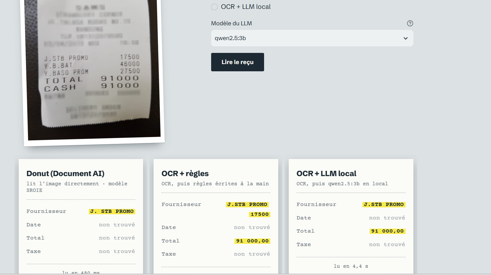
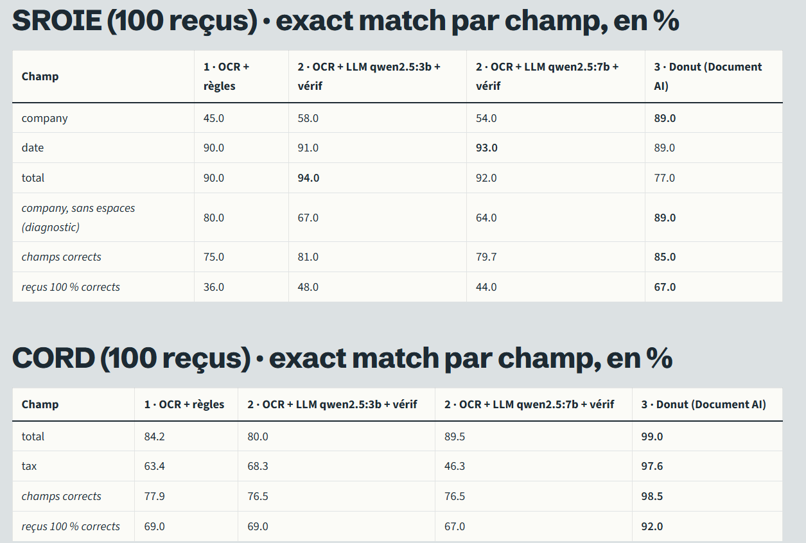

# DOC-EXTRACT

Ce projet lit des tickets de caisse et en sort quatre champs : le fournisseur, la date, le total et la taxe. Je l'ai construit pour comparer trois façons de faire sur les mêmes reçus, avec les mêmes métriques, plutôt que de défendre une méthode choisie à l'avance.



Les trois méthodes :

1. **OCR + règles.** RapidOCR lit le texte, puis des règles écrites à la main (mots-clés, formats de date, calcul « espèces moins monnaie rendue ») cherchent les champs.
2. **OCR + LLM local.** Le même texte OCR est donné à Qwen2.5 (3B ou 7B) via Ollama. La réponse est forcée dans un schéma JSON et validée avec Pydantic. Je vérifie ensuite chaque champ contre le texte du ticket : un montant que le modèle sort mais qui n'est écrit nulle part est rejeté.
3. **Donut.** Un modèle qui lit l'image directement et écrit le JSON, sans OCR. Pour SROIE, j'ai fine-tuné `donut-base` moi-même sur 526 reçus (75 minutes sur le GPU gratuit de Colab). Pour CORD, j'utilise le checkpoint public des auteurs de Donut.

## Résultats

Mesurés sur 100 reçus SROIE et 100 reçus CORD mis de côté pour l'évaluation (je n'ai rien réglé dessus, à cinq reçus près : voir les limites), chaque approche évaluée une seule fois. Exact match par champ, en %.

| Champ | OCR + règles | OCR + LLM 3B | OCR + LLM 7B | Donut |
|---|---|---|---|---|
| SROIE, fournisseur | 45,0 | 58,0 | 54,0 | **89,0** |
| SROIE, date | 90,0 | 91,0 | **93,0** | 89,0 |
| SROIE, total | 90,0 | **94,0** | 92,0 | 77,0 |
| CORD, total | 84,2 | 80,0 | 89,5 | **99,0** |
| CORD, taxe | 63,4 | 68,3 | 46,3 | **97,6** |
| Champs corrects, SROIE / CORD | 75,0 / 77,9 | 81,0 / 76,5 | 79,7 / 76,5 | **85,0 / 98,5** |
| Temps par reçu, image vers JSON (SROIE) | 2,5 s | 5,9 s | 9,9 s | **0,6 s** |
| Mémoire GPU | aucune | 2,2 Go | 2,3 Go + CPU | 1,5 Go |

Tout tourne sur mon PC portable (RTX 2050, 4 Go). Pour les deux premières approches, le temps compte l'OCR, qui tourne sur le CPU. Le détail complet est dans [`results/benchmark_eval.md`](results/benchmark_eval.md).



Ce que j'en retiens :

- Donut gagne presque partout, et de loin sur CORD. Il est aussi le plus rapide, simplement parce qu'il n'y a pas d'OCR avant lui.
- Il n'écrase pas tout pour autant : sur le total des reçus SROIE, les règles (90) et le LLM 3B (94) font mieux que lui (77). Quand il se trompe, c'est souvent un chiffre voisin mal lu (6 pour 8) ou le mauvais montant (le total avant service au lieu du total payé).
- Le LLM 7B ne vaut pas son coût. Il est deux fois plus lent que le 3B, ne tient pas dans 4 Go de VRAM (la moitié du modèle tourne sur le CPU) et ne fait pas mieux.
- Côté fournisseur, la plupart des erreurs de l'OCR sont des espaces perdus (« KEDAIPAPANYEWCHUAN » au lieu de « KEDAI PAPAN YEW CHUAN »). 35 des 55 erreurs des règles sont de ce type. En ignorant les espaces, les règles passent de 45 à 80 % sur ce champ. Je garde l'exact match comme mesure officielle et je montre cette variante à part, en la signalant comme un diagnostic fait après coup.

## Ce qui a coincé en route

Mon premier prompt amélioré pour le LLM faisait monter SROIE mais faisait chuter CORD (le total passait à 62 %). Le modèle inventait des montants plausibles. C'est ce qui m'a conduit à vérifier chaque valeur contre le texte OCR, ce qui a rendu une vingtaine de points sur CORD.

La vérification du nom du fournisseur était d'abord trop stricte : elle rejetait 9 bonnes réponses sur 11 parce que le nom est parfois coupé sur plusieurs lignes ou abîmé par l'OCR. Je l'ai assouplie (fenêtre de 1 à 3 lignes, taux de couverture) et le 7B est passé de 37 à 53 % sur ce champ, sur le jeu de réglage.

Donut entre parfois dans une boucle et sort une séquence mal formée (2 reçus sur 100). Je les compte comme ratés.

À l'évaluation finale, le 3B a bouclé sur un reçu CORD et Ollama a coupé la génération avec une erreur 500, ce qui arrêtait toute l'évaluation. Je traite maintenant cela comme une réponse invalide pour ce reçu seulement.

## Limites

- Le Donut CORD est le checkpoint public, entraîné sur le train de CORD : ses 98,5 % sont « dans le domaine ». Le vrai test de généralisation est SROIE, avec mon propre fine-tuning.
- Cent reçus par jeu, c'est peu : un écart de quelques points n'est pas significatif.
- Cinq reçus de l'échantillon d'évaluation SROIE ont servi de cas de test au tout début, avant que je sépare les jeux de réglage et d'évaluation. Ils ont pu m'influencer légèrement dans l'écriture des premières règles (une seule approche est concernée). Ils sont dans `tests/fixtures/`.
- L'API ne devine pas le type de reçu : pour Donut, il faut choisir `sroie` ou `cord`.
- SROIE contient des reçus malaisiens et CORD des reçus indonésiens. Je n'ai rien testé sur des tickets français ou marocains.

## Lancer le projet

Windows, Python 3.13.

```powershell
py -3.13 -m venv .venv
.\.venv\Scripts\Activate.ps1
pip install -r requirements.txt
pip install -r requirements-rapidocr.txt
pip install -e .
python -m pytest -q
```

Pour chaque approche, il faut en plus :

- **LLM** : [Ollama](https://ollama.com) installé, puis `ollama pull qwen2.5:3b`.
- **Donut** : `pip install torch --index-url https://download.pytorch.org/whl/cu126`, puis `pip install -r requirements-donut.txt`. Mon modèle SROIE (environ 800 Mo) n'est pas dans le dépôt : `colab/DONUT_COLAB.ipynb` le ré-entraîne en une heure et quart sur un GPU T4 gratuit. Il se place dans `data/donut_models/sroie_best`. Le checkpoint CORD se télécharge tout seul.

### La démo

```powershell
pip install -r requirements-demo.txt
python -m streamlit run app/streamlit_app.py
```

Dépose un reçu, choisis une méthode ou les trois, et chacune imprime son ticket avec les champs trouvés et son temps de lecture.

### L'API

```powershell
pip install -r requirements-api.txt
uvicorn docextract.api:app --port 8000
```

La documentation interactive est sur `http://localhost:8000/docs`. `POST /extract` prend une image et renvoie le même JSON pour les trois méthodes (exemple, le temps varie) :

```json
{
  "doc_id": "cord_test_0001",
  "method": "docai",
  "fields": {"company": null, "date": null, "total": "91000.00", "tax": null},
  "latency_ms": 704.0,
  "error": null
}
```

Paramètres : `method` (`docai` par défaut, `rules` ou `llm`), `dataset` (`sroie` ou `cord`, pour Donut) et `llm_model`. Les montants sont des chaînes pour ne pas perdre de décimales. Si une méthode n'est pas disponible (Ollama éteint, modèle absent), l'API répond 503 avec la raison.

### Refaire l'évaluation

```powershell
python scripts/00_prepare_data.py                              # télécharge SROIE et CORD, fixe les échantillons
python scripts/03_run_ocr.py --engine rapidocr --set dev
python scripts/04_eval_rules.py --engine rapidocr --set dev
python scripts/06_eval_llm.py --engine rapidocr --set dev --verify
python scripts/09_run_donut.py --set dev
python scripts/08_eval_donut.py --set dev --preds-dir data/donut_preds_local
python scripts/10_benchmark.py --set dev
```

Le jeu `eval` ne se lance qu'avec `--final`, pour éviter de le régler par accident.

## Organisation

```
src/docextract/   le code : OCR, règles, LLM, vérification, Donut, schéma, métriques, API
app/              la démo Streamlit
scripts/          les étapes, numérotées dans l'ordre où on les lance
colab/            l'entraînement de Donut sur Colab
tests/            environ 300 tests, sans réseau
results/          le tableau final de l'évaluation
```

## Données

[SROIE](https://huggingface.co/datasets/jsdnrs/ICDAR2019-SROIE) (reçus malaisiens : fournisseur, date, total) et [CORD v2](https://huggingface.co/datasets/naver-clova-ix/cord-v2) (reçus indonésiens : total, taxe), tous deux sous CC BY 4.0. Les données ne sont pas dans ce dépôt ; le script `00_prepare_data.py` les télécharge. Donut vient de [naver-clova-ix/donut](https://github.com/clovaai/donut).
